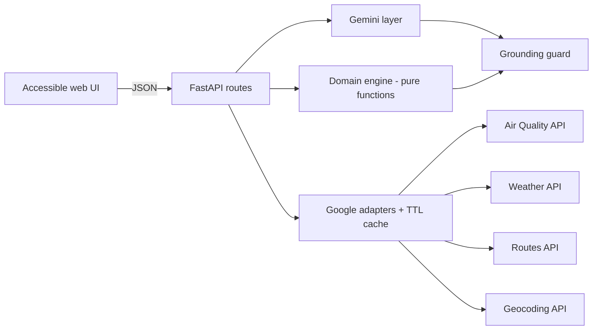

# Saans: Household Air-Exposure Planner

[](https://github.com/AdityaTummuri/Saans/actions/workflows/ci.yml)

*Saans* (साँस) is Hindi for "breath". It treats every family member as a person breathing a measurable dose of pollution, then plans the household's day to cut that dose. Every suggestion comes with an exact number.

## Chosen vertical

Urban Air Quality Assistant (Challenge 6).

## The problem

Winter smog is a dose problem that differs for each family member, not a single AQI number. A grandfather with COPD, a commuter in an open auto-rickshaw and an eight-year-old playing football at 4 pm breathe very different amounts of the same air. Most tools show one number and a list of generic tips. Saans quantifies what each person inhales, finds the changes that cut it the most for the least effort, and says so in English or Hindi.

## Approach and logic

The work is split in two:

- A **deterministic, unit-tested engine** does all the calculation and decision-making.
- **Gemini** understands the family's situation from plain language, explains the plan, and answers follow-up questions. It is never allowed to invent a number.

Three pillars and a ledger:

| Pillar | What it does |
|---|---|
| **Breathe less** | Moves shiftable outdoor activities to the cleanest hours, compares commute modes, and adds a mask, recirculation or a departure shift where an activity cannot move. |
| **Clean indoor air** | A steady-state mass-balance model sizes purifiers, compares sealing window gaps with buying a purifier or building a Corsi-Rosenthal box, and finds the best window to air the house out. |
| **Emit less** | Shows the CO₂ and PM2.5 that trips and household sources (waste burning, coal heating, incense, coils) add, next to the commuter's own exposure, so the trade-off is honest. |
| **Exposure Ledger and Impact Ladder** | Every action is quantified per member (µg avoided, % change, cigarette-equivalent, kg CO₂) and ranked by vulnerability-weighted µg avoided per unit of effort. Purchases are filtered out for a low budget. |

**Smog Stagnation Index.** Calm, humid, hazy air, and clear calm nights with a surface inversion, trap pollution near the ground. A 0 to 100 score per hour from the Weather API breaks ties between hours with similar PM2.5 and explains why an hour is bad.

**Placeholder grounding.** The narrator is told to write with placeholders such as `{{a2.dose_cut_pct}}` and never to write digits. The server rejects any text containing a raw digit (Python's `\d` also catches Devanagari numerals), an unknown placeholder or stray braces, and then falls back to deterministic template text. The Ask agent's tools register every number they return under a placeholder, so its answers go through the same guard. No hallucinated number can reach the user.



## How it works

1. **Describe or load a household.** Write a few sentences and Gemini (Flash-Lite, structured output) fills a profile; the address is geocoded and trips get Routes API durations for every mode. Or load the one-click demo. The profile appears in an editable form so you confirm it before anything is planned.
2. **Plan.** The server fetches a 48-hour air quality forecast and a 48-hour weather forecast (cached), merges them into 24 local hours, and the engine builds the plan. Gemini is called once to explain it.
3. **Read the result.** Today's air, a timeline with the reason for each change, a commute comparison, the Exposure Ledger, the Impact Ladder, room-by-room Home Air with the ventilation window, and Ask Saans.

**Demo household:** a Delhi family of four. Dadaji has COPD, Meera commutes by auto-rickshaw, Rohan drives Aarav to school, and eight-year-old Aarav plays football at 4 pm. With the demo forecast the engine moves football to 2 pm (forecast PM2.5 from 240 to 140 µg/m³, about 42% less inhaled), moves Dadaji's walk to 11 am, suggests a Corsi-Rosenthal box or a sized purifier for the bedrooms, switching Meera to the metro, recirculation for the school run, and flags waste burning.

## Formulas

All constants live in [`app/domain/constants.py`](app/domain/constants.py), each with its source or assumption.

- **Inhaled dose**: `Dose = Σ_hours C_out(h) × MEF × MF × VE × Δt`, in µg. Breathing rate VE (m³/h) by age and intensity follows the US EPA *Exposure Factors Handbook* (2011), Chapter 6.
- **Indoor mass balance**: `C_in = (P·a·C_out + S/V) / (a + k + CADR/V)` with P = 0.9, k = 0.3 h⁻¹, a = 1 h⁻¹ (leaky) or 0.5 h⁻¹ (sealed). For a 36 m³ bedroom at 250 µg/m³ outdoors this gives about 173 (no purifier), 33 (CADR 200 m³/h) and 18 µg/m³ (CADR 200 and sealed gaps); the tests check these.
- **Purifier sizing**: `CADR = max(0, V × ((P·a·C_out + S/V) / C_target − a − k))`, rounded up to 50 m³/h, target 30 µg/m³ (top of the NAQI Good band).
- **Smog Stagnation Index**: `SSI = 100 × (0.4·W + 0.2·H + 0.15·V + 0.25·N)` with W = clamp(1 − wind/15 km/h), H = clamp((RH − 50)/50), V = clamp(1 − visibility/10 km), and N = 0.3 by day or `1 − cloudCover/100` at night. A documented heuristic.
- **Scheduler**: for each shiftable activity, try every whole-hour start inside its window (daylight only for infants and children), pick the lowest vulnerability-weighted dose, break ties by lower SSI then closeness to the original time, and keep the original if the saving is under 10%.
- **Vulnerability weight** (ranking only, never shown as a medical score): the highest of age band and conditions, from 1.0 (healthy adult) to 2.0 (asthma, COPD, heart disease).
- **Impact Ladder**: `score = Σ_m (w_m × ΔDose_m) / effort_tier`, with tiers 1 free or a shift, 2 habit, 3 DIY, 4 purchase; ties go to CO₂ avoided.
- **Cigarette equivalent**: Berkeley Earth, 22 µg/m³ over 24 hours ≈ 1 cigarette. A communication heuristic.
- **NAQI PM2.5 bands (CPCB)**: 0–30 Good, 31–60 Satisfactory, 61–90 Moderate, 91–120 Poor, 121–250 Very Poor, above 250 Severe.

## Google services used

| Need | Google service |
|---|---|
| Air quality forecast, pollutants, local index, health advice | Google Maps Platform Air Quality API |
| Wind, humidity, visibility, day/night, time zone | Google Maps Platform Weather API |
| Commute duration and distance per travel mode | Google Maps Platform Routes API |
| Address to coordinates | Google Maps Platform Geocoding API (server-side) |
| GenAI | Gemini via the official `google-genai` SDK (Vertex AI in production, AI Studio key for local development) |
| Hosting, secrets, builds | Cloud Run, Secret Manager, Cloud Build / Artifact Registry |
| Fonts (Hindi support) | Google Fonts (Noto Sans and Noto Sans Devanagari) |

No other external APIs, SDKs or data providers are used.

## Security

- Gemini is called through Vertex AI with the Cloud Run service account, so no Gemini key exists in production. The one Maps key lives in Secret Manager and is restricted to the four Maps APIs.
- Strict request schemas: latitude and longitude ranges, at most 10 members, durations 0 to 24 h, text up to 2000 characters, unknown fields rejected. Coordinates are rounded to two decimals.
- No server-side storage of health data: the profile lives in the browser session. Nothing from a profile is logged, and error responses carry a stable code and a generic message, never a stack trace or the input.
- Raw user text reaches only the intake model; the narrator sees engine facts with no names or other user text. The Ask agent's tools are read-only.
- All page text is rendered with `textContent`; tests fail the build if `innerHTML`, inline scripts or inline styles appear.
- Content-Security-Policy (self plus Google Fonts), `X-Content-Type-Options`, `Referrer-Policy`, `Permissions-Policy` (geolocation for self only), a request size limit, and per-IP token-bucket rate limits on `/api/ask` and `/api/profile/parse`.
- The container runs as a non-root user.

## Efficiency

48-hour requests only; a TTL cache keyed by rounded location and hour; one Gemini call per plan; Flash-Lite for intake; async I/O with timeouts and a single retry; a zero-framework front end with a small SVG sprite; gzip responses.

## Testing

`pytest` covers the engine with hand-computed expectations (the 36 m³ bedroom, the cleanest-window scheduler, the daylight rule for children, the under-10% rule, the budget filter), mocked Google API responses including error and timeout paths, the grounding guard (invented numbers, Devanagari digits, unknown placeholders, fallbacks), the API (validation, generic errors, headers, rate limits) and static checks on the front end. CI runs `ruff`, `mypy --strict` and `pytest` with a coverage floor.

## Accessibility

Severity is never colour alone: every NAQI band has a label, a signal-bars icon and, for the worst bands, a stripe pattern. Plan updates are announced in an ARIA live region. Everything works from the keyboard with a visible focus ring and a skip link. Controls are at least 44 px. `prefers-reduced-motion` stops all animation, and the page supports `prefers-color-scheme`. Hindi uses the correct `lang` attribute, and there is a larger-text toggle.

## Assumptions

- Forecasts are neighbourhood scale (about 500 m), not street level.
- Breathing rates, microenvironment factors and mask factors are population averages; the values are assumptions documented in `constants.py`.
- The Stagnation Index weights are a documented heuristic.
- Cigarette equivalence is a communication aid.
- Emission factors are representative averages.
- Coordinates are rounded to two decimals, so route durations are approximate.
- Saans gives general guidance, not medical advice.

## Run locally

```bash
pip install -e ".[dev]"
cp .env.example .env      # DEMO_MODE=true runs without any keys
uvicorn app.main:app
pytest
```

Open <http://127.0.0.1:8000>. Add `?demo=1` to the URL to load the demo household straight away, or `?demo=1&tour=1` (the **Watch the demo** button) for a guided, captioned walk through every section: Space pauses, the arrow keys step, Escape ends.

In demo mode the four Google endpoints are answered from recorded responses in `fixtures/demo`, through the same adapters and parsing code as production. Without a Gemini key, the explanations and Ask answers come from deterministic engine templates. To use live data set `MAPS_API_KEY` and either `GEMINI_API_KEY` (AI Studio) or `USE_VERTEX=true` with `GOOGLE_CLOUD_PROJECT`.

## Deploy to Cloud Run

```bash
gcloud run deploy saans --source . --region asia-south1 \
  --set-secrets MAPS_API_KEY=maps-key:latest \
  --set-env-vars USE_VERTEX=true,GOOGLE_CLOUD_LOCATION=global,GOOGLE_CLOUD_PROJECT=<project-id> \
  --max-instances 3 --allow-unauthenticated
```

Grant the service account the Vertex AI User and Secret Manager Secret Accessor roles.

## Deploy to Vercel

1. Import the repository in Vercel. Framework preset: **Other**; leave build and output settings empty. `vercel.json` rewrites every path to the Python function in `api/index.py`, which serves the API and the web UI, and bundles `app/web` and `fixtures`. Dependencies come from `requirements.txt` and the Python version from `.python-version`.
2. Set environment variables (Project Settings, Environment Variables):
   - Keyless demo: `DEMO_MODE=true`.
   - Live: `MAPS_API_KEY` and `GEMINI_API_KEY` (leave `DEMO_MODE` unset or `false`).
3. Deploy. The CLI alternative is `vercel --prod` from the repository root.

The app starts its shared state on the first request, so it does not depend on the ASGI lifespan. On Vercel the client address is the first `X-Forwarded-For` entry. Rate limits and the forecast cache are per function instance, so they are approximate on serverless.

## Licence

See [LICENSE](LICENSE).
