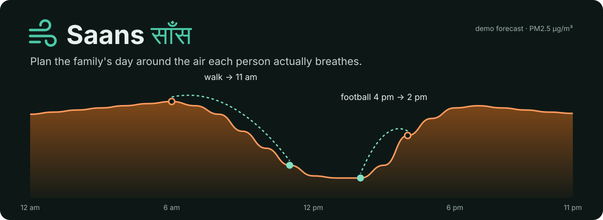
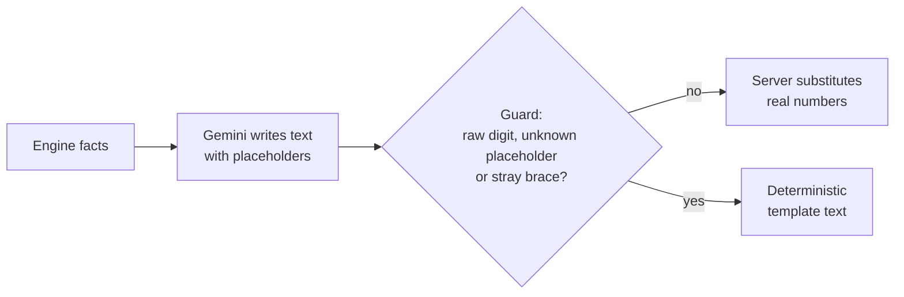
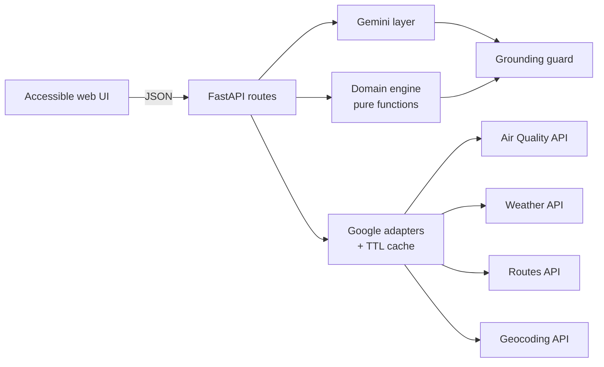

<p align="center">
  
</p>

<p align="center">
  <a href="https://github.com/AdityaTummuri/Saans/actions/workflows/ci.yml"></a>
  
  
  
  
</p>

<p align="center">
  <b>Household Air-Exposure Planner.</b> <i>Saans</i> (साँस) is Hindi for "breath".<br>
  It estimates the pollution dose each family member inhales, then re-plans the day to cut it.<br>
  Every suggestion comes with a number.
</p>

<p align="center">
  <a href="#quick-start">Quick start</a> ·
  <a href="#what-a-plan-looks-like">Example plan</a> ·
  <a href="#how-it-works">How it works</a> ·
  <a href="#the-maths">The maths</a> ·
  <a href="#deploy">Deploy</a>
</p>

---

## Quick start

No API keys needed. Demo mode runs on recorded data. Requires Python 3.12 or newer.

```bash
git clone https://github.com/AdityaTummuri/Saans.git && cd Saans
python3 -m venv .venv && source .venv/bin/activate
pip install -e ".[dev]"
cp .env.example .env          # DEMO_MODE=true
uvicorn app.main:app
```

| Open | You get |
|---|---|
| <http://127.0.0.1:8000> | The planner |
| <http://127.0.0.1:8000/?demo=1> | The demo household, already loaded |
| <http://127.0.0.1:8000/?demo=1&tour=1> | A captioned walkthrough: Space pauses, arrow keys step, Escape ends |

## Chosen vertical

Urban Air Quality Assistant (Challenge 6).

## The problem

Winter smog is not one number. A grandfather with COPD, a commuter in an open auto-rickshaw and an eight-year-old playing football at 4 pm breathe very different amounts of the same air. Most tools show a single AQI and a list of generic tips.

Saans works out what each person inhales, finds the changes that cut it the most for the least effort, and explains them in English or Hindi.

## What a plan looks like

The built-in demo is a Delhi family of four on a winter day: **Dadaji** (COPD), **Meera** (commutes by auto-rickshaw), **Rohan** (drives the school run) and **Aarav** (8, football at 4 pm).

| Change | Effect |
|---|---|
| Football practice, 4 pm → 2 pm | PM2.5 240 → 140 µg/m³, **42% less** inhaled |
| Dadaji's walk, 6:30 am → 11 am | PM2.5 317 → 170 µg/m³, **46% less** inhaled |
| Corsi-Rosenthal box in Dadaji's room | Indoor PM2.5 210 → 34 µg/m³, **84% less** inhaled |
| Meera takes the metro | **37% less** inhaled, 0.5 kg CO₂ avoided |
| N95 on the school run | **60% less** inhaled |
| Skip waste burning | 20 g PM2.5 and 2.2 kg CO₂ kept out of the neighbourhood |

Modelled daily dose with the whole plan followed:

| Member | Before (µg) | After (µg) | Change |
|---|--:|--:|--:|
| Dadaji | 1538 | 209 | −86% |
| Meera | 1266 | 111 | −91% |
| Rohan | 1208 | 97 | −92% |
| Aarav | 1557 | 452 | −71% |

<sub>Model estimates on the demo forecast, not measurements.</sub>

## Approach and logic

The work is split in two, and the split is strict:

- A **deterministic, unit-tested engine** does every calculation and makes every decision.
- **Gemini** reads the family's situation from plain language, explains the plan and answers follow-up questions. It is never allowed to invent a number.

### Three pillars and a ledger

| Pillar | What it does |
|---|---|
| 🫁 **Breathe less** | Moves flexible outdoor activities to cleaner hours and compares commute modes. Where something cannot move, adds a mask, recirculation or a departure shift. |
| 🏠 **Clean indoor air** | A mass-balance model sizes purifiers, compares sealing window gaps with a purifier or a DIY Corsi-Rosenthal box, and finds the best time to air the house. |
| 🌱 **Emit less** | Shows the CO₂ and PM2.5 that trips and household sources (waste burning, coal heating, incense, coils) add, next to the commuter's own exposure, so trade-offs are visible. |
| 📒 **Exposure Ledger and Impact Ladder** | Quantifies each action per member (µg avoided, % change, cigarette-equivalent, kg CO₂) and ranks them by vulnerability-weighted benefit per unit of effort. Low budgets see no purchases. |

### Smog Stagnation Index

Calm, humid, hazy air and clear still nights trap pollution near the ground. Each hour gets a 0 to 100 score from weather data. It breaks ties between hours with similar PM2.5 and explains *why* an hour is bad.

### The grounding guard

The model writes placeholders such as `{{a2.dose_cut_pct}}`, never digits. The server fills them in from engine output.



The digit check also catches Devanagari numerals. The Ask agent's tools register every number they return under a placeholder, so its answers pass through the same guard.

## How it works

1. **Describe or load a household.** Write a few sentences and Gemini fills a structured profile. The address is geocoded and each trip gets durations for every travel mode. Or load the one-click demo.
2. **Confirm it.** The profile appears in an editable form before anything is planned.
3. **Plan.** The server fetches 48-hour air quality and weather forecasts (cached), merges them into 24 local hours, and the engine builds the plan. Gemini is called once to explain it.
4. **Read the result.** Today's air, a timeline with the reason for each change, a commute comparison, the Exposure Ledger, the Impact Ladder, room-by-room Home Air with a ventilation window, and Ask Saans.

### Architecture



### Project layout

```text
app/
  domain/      pure engine: exposure, indoor air, scheduling, ranking, constants
  services/    Google API adapters, cache, Gemini, grounding guard
  api/         routes, request schemas, rate limiting
  web/         framework-free HTML, CSS and JS
api/           Vercel serverless entrypoint
fixtures/demo/ recorded responses for demo mode
tests/         engine, adapters, API, security and front-end checks
```

### API

| Method | Path | Purpose |
|---|---|---|
| `GET` | `/healthz` | Status, mode and whether Gemini is configured |
| `GET` | `/api/demo` | The demo household (`?language=en` or `hi`) |
| `POST` | `/api/profile/parse` | Plain-language description to household profile (needs Gemini, rate limited) |
| `POST` | `/api/plan` | Household to full plan with explanations |
| `POST` | `/api/ask` | Grounded follow-up question (rate limited) |

```bash
curl -s http://127.0.0.1:8000/api/demo > household.json
printf '{"household": %s}' "$(cat household.json)" |
  curl -s http://127.0.0.1:8000/api/plan -H 'Content-Type: application/json' -d @-
```

## The maths

All constants live in [`app/domain/constants.py`](app/domain/constants.py), each with its source or assumption.

| Quantity | Formula |
|---|---|
| Inhaled dose (µg) | `Σ_hours C_out(h) × MEF × MF × VE × Δt` |
| Indoor concentration | `C_in = (P·a·C_out + S/V) / (a + k + CADR/V)` |
| Purifier size | `CADR = max(0, V × ((P·a·C_out + S/V) / C_target − a − k))` |
| Smog Stagnation Index | `100 × (0.4·W + 0.2·H + 0.15·V + 0.25·N)` |
| Impact Ladder score | `Σ_m (w_m × ΔDose_m) / effort_tier` |

<details>
<summary><b>Parameters and rules</b></summary>

<br>

- **Dose:** MEF is the microenvironment factor, MF the mask factor, VE the breathing rate (m³/h) by age and intensity, from the US EPA *Exposure Factors Handbook* (2011), Chapter 6.
- **Indoor air:** P = 0.9, k = 0.3 h⁻¹, a = 1 h⁻¹ (leaky) or 0.5 h⁻¹ (sealed). For a 36 m³ bedroom at 250 µg/m³ outdoors this gives about 173 µg/m³ with no purifier, 33 with CADR 200 m³/h, and 18 with CADR 200 and sealed gaps. The tests check these.
- **Purifier size:** rounded up to the next 50 m³/h, target 30 µg/m³ (top of the NAQI Good band).
- **Stagnation:** W = clamp(1 − wind / 15 km/h), H = clamp((RH − 50) / 50), V = clamp(1 − visibility / 10 km), N = 0.3 by day or `1 − cloudCover/100` at night. A documented heuristic.
- **Scheduler:** try every whole-hour start inside each flexible activity's window (daylight only for infants and children), pick the lowest vulnerability-weighted dose, break ties by lower stagnation then closeness to the original time. Keep the original if the saving is under 10%.
- **Vulnerability weight:** the highest of age band and conditions, from 1.0 (healthy adult) to 2.0 (asthma, COPD, heart disease). Used for ranking only, never shown as a medical score.
- **Effort tiers:** 1 free or a time shift, 2 habit, 3 DIY, 4 purchase. Ties go to CO₂ avoided.
- **Cigarette equivalent:** Berkeley Earth, 22 µg/m³ over 24 hours ≈ 1 cigarette. A communication aid.
- **NAQI PM2.5 bands (CPCB):** 0–30 Good, 31–60 Satisfactory, 61–90 Moderate, 91–120 Poor, 121–250 Very Poor, above 250 Severe.

</details>

## Google services used

| Need | Service |
|---|---|
| Air quality forecast, pollutants, local index, health advice | Maps Platform Air Quality API |
| Wind, humidity, visibility, day/night, time zone | Maps Platform Weather API |
| Commute duration and distance per mode | Maps Platform Routes API |
| Address to coordinates (server-side) | Maps Platform Geocoding API |
| Generative AI | Gemini via the `google-genai` SDK (Vertex AI in production, AI Studio key locally) |
| Hosting, secrets, builds | Cloud Run, Secret Manager, Cloud Build, Artifact Registry |
| Fonts, including Devanagari | Google Fonts (Noto Sans, Noto Sans Devanagari) |

No other external APIs, SDKs or data providers are used.

## Configuration

Settings come from the environment or `.env`. Blank values count as unset.

| Variable | Default | Purpose |
|---|---|---|
| `DEMO_MODE` | `false` (`true` in `.env.example`) | Serve recorded responses; no keys needed |
| `MAPS_API_KEY` | | Required for live data |
| `GEMINI_API_KEY` | | AI Studio key |
| `USE_VERTEX` | `false` | Use Vertex AI instead of an API key |
| `GOOGLE_CLOUD_PROJECT` | | Project for Vertex AI |
| `GOOGLE_CLOUD_LOCATION` | `global` | Vertex AI location |
| `GEMINI_MODEL` | `gemini-3.7-flash` | Narration and Ask |
| `GEMINI_LITE_MODEL` | `gemini-3.5-flash-lite` | Profile intake |

Demo mode answers the four Maps endpoints from `fixtures/demo`, through the same adapters and parsing code as production. Without Gemini, explanations and Ask answers come from deterministic templates.

## Engineering

### Security and privacy

- **No stored health data.** The profile lives in the browser session. Nothing from it is logged.
- **No Gemini key in production.** Vertex AI uses the Cloud Run service account. The one Maps key lives in Secret Manager, restricted to the four Maps APIs.
- **Strict inputs.** Coordinate ranges, at most 10 members, durations of 0 to 24 h, text up to 2000 characters, unknown fields rejected, coordinates rounded to two decimals.
- **Safe errors.** A stable code and generic message, never a stack trace or the input.
- **Contained model access.** Raw user text reaches only the intake model. The narrator sees engine facts with no names or other user text. The Ask agent's tools are read-only.
- **Hardened web layer.** All text is rendered with `textContent`, and tests fail on `innerHTML`, inline scripts or inline styles. CSP, `nosniff`, `Referrer-Policy`, `Permissions-Policy`, request size limit, per-IP rate limits, non-root container.

### Accessibility

Severity is never colour alone: every NAQI band has a label and a signal-bars icon, and the worst bands add a stripe pattern. Plan updates are announced in an ARIA live region. Everything works from the keyboard, with a visible focus ring and skip link. Controls are at least 44 px. Light and dark themes, reduced motion, a larger-text toggle, and correct `lang` attributes for Hindi.

### Efficiency

48-hour requests only, a TTL cache keyed by rounded location and hour, one Gemini call per plan, a lighter model for intake, async I/O with timeouts and one retry, gzip, and no front-end framework.

### Testing

```bash
ruff check app tests api && ruff format --check app tests api
mypy
pytest --cov=app --cov-fail-under=90
```

The suite covers the engine against hand-computed expectations, mocked Google responses including errors and timeouts, the grounding guard (invented numbers, Devanagari digits, unknown placeholders), the API (validation, headers, rate limits) and static front-end checks. CI runs all of the above on every push to `main`.

## Deploy

### Cloud Run

```bash
gcloud run deploy saans --source . --region asia-south1 \
  --set-secrets MAPS_API_KEY=maps-key:latest \
  --set-env-vars USE_VERTEX=true,GOOGLE_CLOUD_LOCATION=global,GOOGLE_CLOUD_PROJECT=<project-id> \
  --max-instances 3 --allow-unauthenticated
```

Grant the service account the **Vertex AI User** and **Secret Manager Secret Accessor** roles.

<details>
<summary><b>Vercel</b></summary>

<br>

1. Import the repository. Framework preset: **Other**; leave build and output settings empty. `vercel.json` rewrites every path to `api/index.py`, which serves both the API and the UI.
2. Set environment variables. Keyless demo: `DEMO_MODE=true`. Live: `MAPS_API_KEY` and `GEMINI_API_KEY`.
3. Deploy, or run `vercel --prod` from the repository root.

Shared state starts on the first request, so the app does not depend on the ASGI lifespan. Rate limits and the forecast cache are per function instance, so they are approximate on serverless.

</details>

## Assumptions

- Forecasts are neighbourhood scale (about 500 m), not street level.
- Breathing rates, microenvironment factors and mask factors are population averages, documented in `constants.py`.
- Stagnation Index weights are a heuristic.
- Cigarette equivalence is a communication aid.
- Emission factors are representative averages.
- Coordinates are rounded to two decimals, so route durations are approximate.

> [!IMPORTANT]
> Saans gives general guidance, not medical advice.

## Licence

See [LICENSE](LICENSE).
